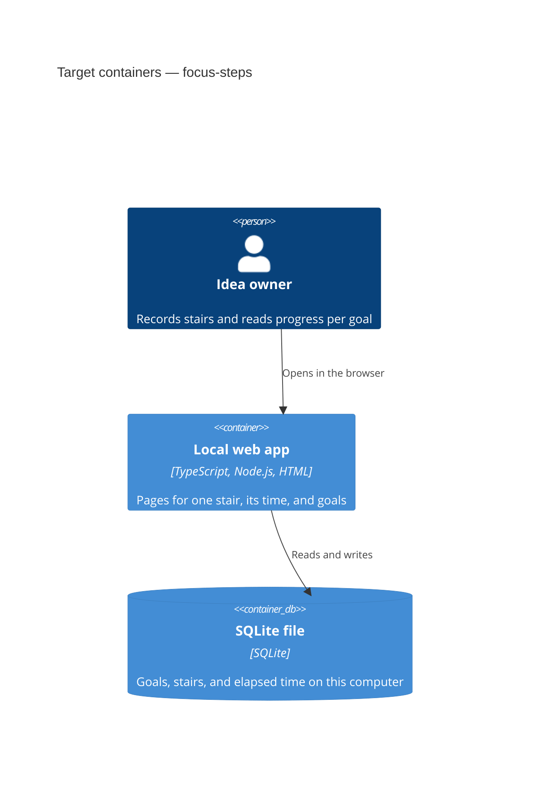

# Architecture map — focus-steps

> Target foundation for an empty repository (`mode: greenfield-bootstrap`). No application
> source exists yet. Paths below are the layout `scaffold` will create. They are not a scan
> of current code. `reflects_commit` is the commit this session started from.

## Stack

Decided 2026-10-31 when the owner accepted the foundation bundle. Tool versions are not pinned.

- Language / runtime: TypeScript on Node.js (ADR-0001).
- Frameworks: a small Node HTTP server. Pages are server-rendered HTML plus one CSS file. No React, no Tailwind.
- Datastore: one SQLite file on this computer, changed through dbmate SQL migrations (ADR-0003).
- Build / test / lint: `npm run build`, `npm test` (Vitest), `npm run lint` (ESLint). CI runs those three.

## C4 — system as it is

Target containers. Nothing in this diagram is running today.

Google Calendar is not a container. Live lectures stay there (`docs/idea-brief.md` §5).

## Module inventory

Target layout. None of these directories exist until scaffold S1. The baseline module is `health`, so the process can boot before any product feature.

| Module | Path | Layers | Wired at | Responsibility |
|---|---|---|---|---|
| health | `src/modules/health/` | http, service, repo | `src/index.ts` (scaffold S1) | Baseline module that proves boot |
| db | `src/db/` | infra | `src/db/sqlite.ts` (scaffold S1) | Opens the SQLite file |
| ui | `src/ui/` | ui | `src/ui/styles.css` (scaffold S1) | Shared page styling |

A later product area (a goal, a stair) is a new folder under `src/modules/` with the same three layers. That work is not part of the skeleton.

## Conventions (cited — the rules a new feature must match)

Source files do not exist yet. Each rule cites the ADR that fixes it.

- **Module wiring / registration:** one folder per area, three files (`http`, `service`, `repo`), composed from `src/index.ts`. — `docs/adr/0002-lay-modules-out-in-three-layers.md`
- **Error handling:** one payload `{ code, message }` on HTTP errors. An HTML page shows `message`. — `docs/adr/0001-serve-a-local-typescript-web-app.md`
- **IDs:** the application generates a ULID before insert. The database does not assign the id. — `docs/adr/0003-store-data-in-a-sqlite-file.md`
- **Persistence / DB access:** SQL against one SQLite file through the module `repo`. The database stores rows. It does not hold product rules. — `docs/adr/0003-store-data-in-a-sqlite-file.md`
- **Migrations:** numbered SQL files with an up step and a down step, applied with dbmate, directory `migrations/`. — `docs/adr/0003-store-data-in-a-sqlite-file.md`
- **Tests:** Vitest. An integration test uses a temporary SQLite file. The skeleton smoke test boots the process. — `docs/adr/0001-serve-a-local-typescript-web-app.md`
- **Inter-module communication:** a direct function call inside the process. No message bus and no public HTTP API for other programs. — `docs/adr/0002-lay-modules-out-in-three-layers.md`
- **UI / styling:** server-rendered HTML and one shared CSS file. No component kit. — `docs/adr/0001-serve-a-local-typescript-web-app.md`

## Datastores

| Store | Engine | Accessed via | Notes |
|---|---|---|---|
| Local file `data/focus-steps.sqlite` | SQLite | module `repo`, opened in `src/db/sqlite.ts` | This computer only. The file is gitignored. No account and no sync. |

## Frontend / UI foundation

The UI is the pages the local server renders. There is no component library in the repository yet.

- **Component library / design system:** none. Pages are HTML rendered by the Node process. — `docs/adr/0001-serve-a-local-typescript-web-app.md`
- **Design tokens:** none yet. Scaffold does not invent a theme. — `docs/adr/0001-serve-a-local-typescript-web-app.md`
- **Styling approach:** one shared CSS file, `src/ui/styles.css`. Not Tailwind, not CSS modules. — `docs/adr/0001-serve-a-local-typescript-web-app.md`
- **Shared primitives:** none yet. The skeleton does not add buttons or cards in advance. — `docs/adr/0001-serve-a-local-typescript-web-app.md`
- **State / data-fetching:** the server reads SQLite and renders HTML. No client store. — `docs/adr/0003-store-data-in-a-sqlite-file.md`
- **Closest UI precedent:** none. The first product screen is specified later and uses the same server-rendered HTML.

## Where things live / closest precedents

- A new product module → `src/modules/<area>/` with `http`, `service`, and `repo`, modelled on `src/modules/health/` after scaffold. Rule: `docs/adr/0002-lay-modules-out-in-three-layers.md`.
- A new screen → server-rendered HTML using `src/ui/styles.css`. No existing screen to copy. Rule: `docs/adr/0001-serve-a-local-typescript-web-app.md`.

## Constraints & known tech-debt

- One person uses the app on one computer. No account and no sync. A second device does not see the stairs. Accepted with the foundation, 2026-10-31. This answers the nonblocking storage question in `docs/idea-brief.md` §8.
- Live lectures stay in Google Calendar. The app does not read or write that calendar. — `docs/idea-brief.md` §5
- The first product version does not include achievements, work-interval and break settings, or a finish line on a goal. The skeleton must not add them. — `docs/idea-brief.md` §5
- No application source, tests, or migrations exist yet. `reflects_commit` `7fc0408` is the idea brief, not a built system.
- Tool versions (Node, TypeScript, Vitest, ESLint, dbmate) are not pinned.

## Reconciliation with the authored architecture doc

No authored architecture doc. This map is the foundation reference. `docs/idea-brief.md` is the product intent, not an architecture document.
