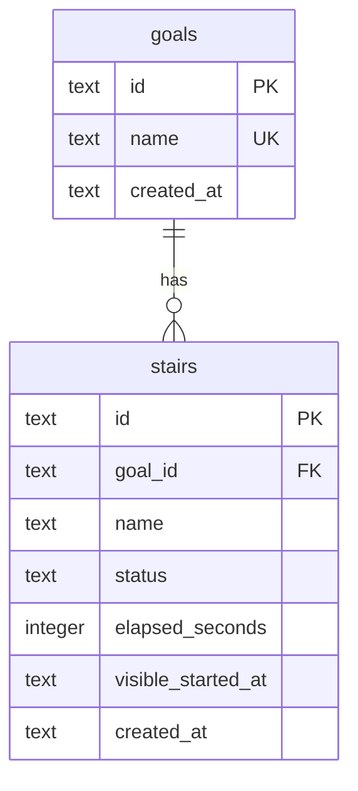

# Data model — focus-steps

## ER diagram

## Entities

### Aggregate: Goal (root)

Goal owns its stairs. A stair always references a goal (`goal_id`). Goal total is **not** a column — derived on read as the sum of finished stairs' `elapsed_seconds` (feature ADR-0004).

**PK strategy (repo / ADR-0003):** application-generated ULID stored as SQLite `TEXT`. The database does not assign ids.

**Delete strategy:** no soft-delete columns. Spec v1 does not remove goals or stairs; rows are kept. Corrections update name/time in place.

**Audit columns:** `created_at` TEXT (ISO-8601 UTC) on insert only. No `updated_at`.

### `goals`

| Column | Type | Constraints | Notes |
|---|---|---|---|
| `id` | TEXT | PK | App-generated ULID |
| `name` | TEXT | NOT NULL, UNIQUE | Stored trimmed on write (AC-11); SQLite TEXT compare is case-sensitive |
| `created_at` | TEXT | NOT NULL | ISO-8601 UTC set by the application on insert |

**Aggregate root:** root.
**Access patterns:** find-or-create by trimmed name → `goals_name_uk`; list goal names on home → full table read (one Owner).
**Constraints:** UNIQUE on `name` (service trims before write/lookup).

### `stairs`

| Column | Type | Constraints | Notes |
|---|---|---|---|
| `id` | TEXT | PK | App-generated ULID |
| `goal_id` | TEXT | NOT NULL, FK → `goals(id)` | Indexed (`stairs_goal_id_idx`) |
| `name` | TEXT | NOT NULL | Duplicate names under one goal allowed (AC-17) |
| `status` | TEXT | NOT NULL, CHECK (`open` \| `finished`) | At most one `open` row (partial unique index) |
| `elapsed_seconds` | INTEGER | NOT NULL, CHECK `>= 0` | Open: closed visibility segments so far; finished: frozen span (or corrected time) |
| `visible_started_at` | TEXT | NULL | ISO-8601 UTC start of the current visible segment; NULL when paused or finished (ADR-0003) |
| `created_at` | TEXT | NOT NULL | ISO-8601 UTC set by the application on insert |

**Aggregate root:** Goal.
**Access patterns:** read whether a stair is open → `stairs_one_open_uk`; finished stairs for a goal → `stairs_goal_id_idx` + `status = 'finished'`; pause/resume updates the open row's `elapsed_seconds` / `visible_started_at`.
**Constraints:** CHECK on `status` and `elapsed_seconds >= 0`; FK → `goals(id)`; partial UNIQUE so only one `status = 'open'` row exists.

Open-stair display time (not a column): `elapsed_seconds` plus seconds since `visible_started_at` when that column is non-NULL — computed in `service`.

## Indexes

| Index | Columns | Query it serves |
|---|---|---|
| `goals_name_uk` | `name` UNIQUE | Open one stair — find or create goal by trimmed name (AC-11); refuse empty goal name never hits this |
| `stairs_goal_id_idx` | `goal_id` | FK hygiene; See a goal's progress — read finished stairs for that goal (AC-03 / AC-12 / AC-17); correct re-reads finished stairs |
| `stairs_one_open_uk` | expression / partial UNIQUE on open | Open one stair / second stair refused — read whether a stair is already open (AC-01 / AC-06); pause/home read the single open row (AC-08 / AC-15) |

## Test fixtures

Not in migrations. Vitest helpers (to be added under tests when `implement` lands), PII-safe only:

- `newGoal({ id?, name, createdAt? })` — inserts a `goals` row with a fixed ULID in tests.
- `newOpenStair({ id?, goalId, name, elapsedSeconds?, visibleStartedAt?, createdAt? })` — inserts `status = 'open'`.
- `newFinishedStair({ id?, goalId, name, elapsedSeconds, createdAt? })` — inserts `status = 'finished'`, `visible_started_at = NULL`.
