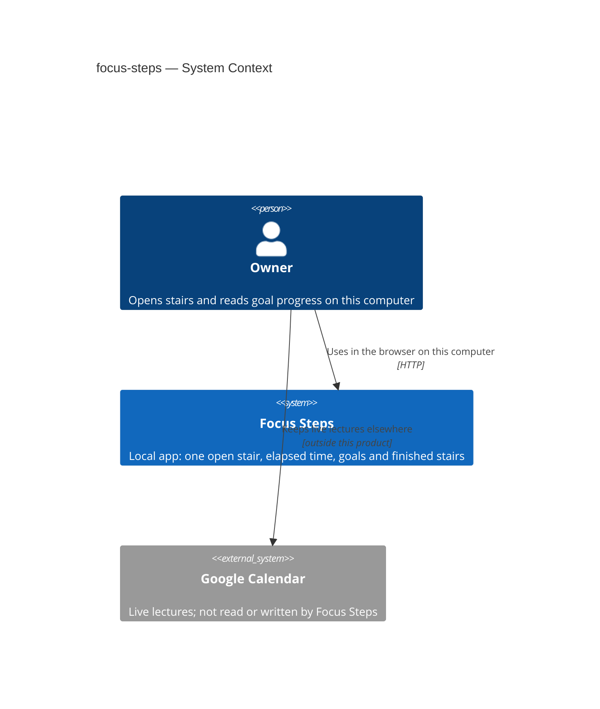
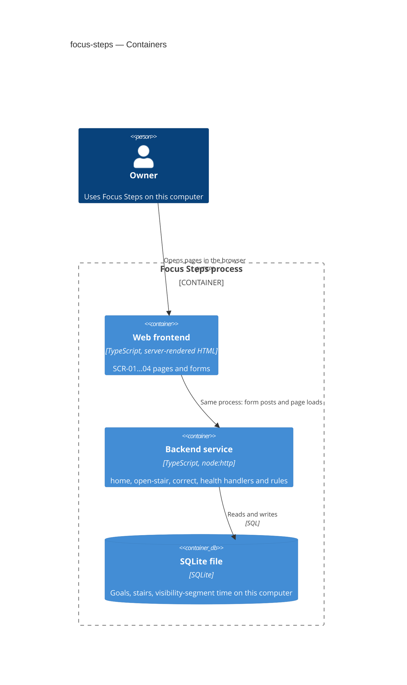
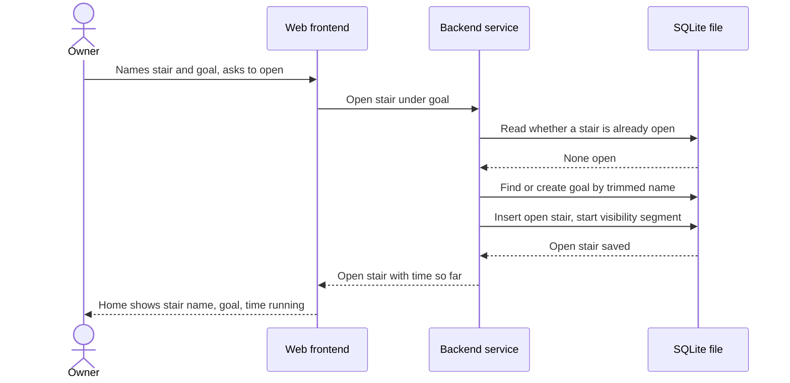

# Software Architecture Document — focus-steps

## 1. Introduction and goals

**Intent.** Focus Steps is a local tool for the Owner. They open one stair under a named goal, keep time while they can see the app, mark the stair done, and read that goal's finished stairs and total time. A finished stair's name or time can be corrected, and the goal total follows the correction.

**Top-3 quality goals (1-liners; full scenarios in §10):**

1. Goal progress appears within 1 second of asking for that goal (spec §6).
2. Goals and stairs survive closing the last view, a crash, or a power loss; an open stair stays open and the gap adds 0 seconds (spec §6).
3. Shown time on a finished stair stays within 1 second of the time counted while the Owner could see the app, or of a correction (spec §6).

**Stakeholders.**

| Role | Interest | Sign-off owner? |
|---|---|---|
| Owner | Opens stairs and reads goal progress | No |
| Tech Lead | SAD approval | Yes |
| Security Lead | Personal notes on one computer; review before this design ships | Yes |

<!-- Decision overrides (¶4) — populated by the critic resolution loop, empty otherwise. -->

## 2. Constraints

**Technical.**
- TypeScript on Node.js (the skeleton was brought up on Node 24; `node:sqlite` and `node:http`). — `docs/adr/0001-serve-a-local-typescript-web-app.md`
- One local HTTP process serves server-rendered HTML and one CSS file. No React, no Tailwind. — same ADR
- One SQLite file (`data/focus-steps.sqlite` by default; tests set `SQLITE_PATH`), opened through `src/db/sqlite.ts`. Migrations via dbmate. Application-generated ULIDs. — `docs/adr/0003-store-data-in-a-sqlite-file.md`
- Each product area is `src/modules/<area>/{http,service,repo}`; modules call each other by direct function call. — `docs/adr/0002-lay-modules-out-in-three-layers.md`

**Organisational.**
- Effort budget: `<TBD by PM>`
- Deadline: none in `spec.md` §8 — tracked in §11
- Team: one Owner building for themselves; Tech Lead and Security Lead sign off on this SAD

**Conventions.**
- Project map and conventions: `docs/architecture-map.md` and foundation ADRs `docs/adr/0001`–`0003`
- HTTP errors: JSON `{ code, message }`; an HTML page may show `message`
- IDs: ULID generated in the application before insert
- Persistence: `repo` runs SQL; product rules stay in `service`
- Tests: Vitest; integration tests use a temporary SQLite file

**Regulatory / external.**
- Data classification: confidential personal notes (goal names, stair names, time). No account and no separate login. Anyone at this computer can read the notes. Another computer is not given a way in (`spec.md` §6.1, AC-05).
- Abuse controls that shape design: stair names are stored and shown as text, not run as commands; at most one open stair at a time.
- Security review: required before this design ships (feature size M). Google Calendar stays outside the system.

## 3. Context and scope

The Owner keeps study work as named stairs under goals. Paper does not record how long a stair took or show progress on a goal. This system is the local app on their computer that opens one stair at a time, counts time while they can see it, and shows finished stairs and totals per goal. Nothing outside this computer is part of the product boundary.

<!-- brownfield: scaffold present — `src/modules/health/`, `src/db/sqlite.ts`, `src/ui/styles.css`; no goals/stairs modules yet. Architecture map `reflects_commit` 7fc0408 is stale vs HEAD. -->

**External systems (in / out):**

| Actor or system | Type | Interaction |
|---|---|---|
| Owner | Person | Opens stairs, marks them done, reads goals, corrects finished stairs |
| Google Calendar | System (external, out of scope) | Not connected. Live lectures stay there (`spec.md` §3) |
| Other computers / accounts | — | None. No sync and no login (`spec.md` AC-05) |

External: none in v1 (deliberate). The trust zone ends at this computer's process and its SQLite file.

**C4 Context (L1):**



## 4. Solution strategy

**Top strategic choices (the seeds for ADRs):**

1. **Backend service + web frontend in one local process** — `target_surfaces: [backend-service, web-frontend]`. Screens SCR-01…04 need a UI surface; handlers and SQLite need a backend surface. Both run in the existing Node process (feature ADR-0001).

2. **Server-rendered HTML for the web surface** — product screens are HTML from the Node process plus `src/ui/styles.css`. No SPA and no client store. Inherits foundation `docs/adr/0001-serve-a-local-typescript-web-app.md` (inline; no new feature ADR).

3. **Three product modules by screen cluster** — `home` (SCR-01 + SCR-03), `open-stair` (SCR-02), `correct` (SCR-04). Feature ADR-0002. Direct calls; one-open-stair checked when opening.

4. **Open-stair time as visibility segments** — accumulated seconds plus the current visible segment start; pause when the app is not visible (last view closed, crash, power loss → gap 0 s); several views share one open stair. Feature ADR-0003.

**Inherited (not reopened):** sync direct calls between modules (`docs/adr/0002`); one SQLite file and app ULIDs (`docs/adr/0003`).

Each tactical decision in later sections should trace to one of these seeds.

## 5. Building block view

Layering follows the repo convention: each product area is `http` (request/response and HTML), `service` (product rules), `repo` (SQL). Direct function calls between modules; no message bus. Chosen because the skeleton and ADR-0002 already fix this shape, and the feature adds three areas beside `health`.

**Internal decomposition:**

```
src/
├── index.ts                 wires HTTP server + modules
├── db/sqlite.ts             opens the SQLite file
├── ui/styles.css            shared styles
└── modules/
    ├── health/              boot baseline (existing)
    ├── home/                SCR-01 Home, SCR-03 Goal
    │   ├── http.ts
    │   ├── service.ts
    │   └── repo.ts
    ├── open-stair/          SCR-02 Open a stair
    │   ├── http.ts
    │   ├── service.ts
    │   └── repo.ts
    └── correct/             SCR-04 Correct a stair
        ├── http.ts
        ├── service.ts
        └── repo.ts
```

**C4 Container (L2):**



`web` and `api` are two surfaces in one OS process (feature ADR-0001). They are not separately deployed.

## 6. Runtime view

Participants use §5 container names. Messages are semantic (no HTTP verbs or paths). Full AC coverage is for the `sequences` stage; here we seed the primary flows.

**Critical flow 1: Open one stair (happy path, US-01 / AC-01 / AC-09)**



**Critical flow 2: Second stair refused (US-05 / AC-06)**

```mermaid
sequenceDiagram
    actor Owner
    participant Web as Web frontend
    participant Backend as Backend service
    participant Store as SQLite file
    Owner->>Web: Tries to open another stair
    Web->>Backend: Open stair under goal
    Backend->>Store: Read whether a stair is already open
    Store-->>Backend: One stair open
    Backend-->>Web: Refuse — mark the current stair done first
    Note over Backend,Store: No goal created, no second stair written
    Web-->>Owner: Plain explanation; current stair still open
```

**Critical flow 3: Pause when the app is no longer visible (AC-08 / ADR-0003)**

```mermaid
sequenceDiagram
    actor Owner
    participant Web as Web frontend
    participant Backend as Backend service
    participant Store as SQLite file
    Owner->>Web: Closes the last view (or crash / power loss ends the process)
    Web->>Backend: App no longer visible
    Backend->>Store: Close current visibility segment into accumulated seconds
    Store-->>Backend: Open stair kept; gap not added
    Note over Owner,Store: Later the Owner opens the app again
    Owner->>Web: Opens the app on this computer
    Web->>Backend: Show home with open stair
    Backend->>Store: Read open stair and start a new visibility segment
    Store-->>Backend: Open stair still the only open one
    Backend-->>Web: Stair name, goal, time so far (gap was 0 s)
    Web-->>Owner: Same open stair; time runs again
```

## 7. Deployment view

One Node.js process on the Owner's computer listens on loopback (`127.0.0.1`, port `PORT` or `3000`). There are no replicas and no horizontal scale-out. The SQLite file lives on the same machine (`data/focus-steps.sqlite` by default). Closing the process or losing power stops serving pages; the file remains.

**Monitoring:**
- Metrics — none beyond what the Owner sees in the UI in v1 (no hosted metrics stack).
- Alerts — none; single-user local tool.
- Tracing — none in v1.

**Scaling thresholds:**
- Comfortable as one SQLite file for one Owner's goals and stairs on one computer.
- No partition plan in v1; volume growth is accepted as a later concern if the file becomes slow on the Owner's machine.

## 8. Crosscutting concepts

| Concept | Convention | Where defined |
|---|---|---|
| Logging | Minimal process logging in v1; no structured log product yet | Inline for this feature |
| Authentication | None — no account, no login | `docs/adr/0001`, `spec.md` §6.1 |
| Authorization | Anyone at this computer; process listens on loopback only | `src/index.ts`, AC-05 |
| Error handling | JSON `{ code, message }`; HTML may show `message` | `docs/adr/0001`, `health` `writeError` |
| ID strategy | Application-generated ULID before insert | `docs/adr/0003` |
| Internationalisation | Single language (English copy in v1 product text as Owner uses) | Inline |
| Observability | No hosted metrics/tracing in v1 | SAD §7 |
| Events | None — direct function calls only | `docs/adr/0002` |
| Stair name handling | Stored and shown as text the Owner typed; never executed as a command | `spec.md` §6.1 |
| Goal total | Derived when reading finished stairs (sum of their times), not a separate writable counter | Feature ADR-0004 |

## 9. Architecture decisions

| # | Title | Status | Section |
|---|---|---|---|
| 0001 | Deliver Focus Steps as a backend service and a web frontend surface | Accepted | §4 |
| 0002 | Split the product into home, open-stair, and correct modules | Accepted | §4 |
| 0003 | Count open-stair time as visibility segments | Accepted | §4 |
| 0004 | Derive the goal total when reading finished stairs | Accepted | §8 |

ADR files live under `docs/features/focus-steps/adr/NNNN-<title>.md`.

## 10. Quality requirements

Each top-3 goal from §1 expanded into a full scenario. Numbers from `spec.md` §6 verbatim.

**QG-1. Goal progress appears within 1 second**
- **When:** The Owner asks to open a goal that already has finished stairs on this computer
- **Then:** Finished stairs and the total are visible in ≤ 1 second from asking for that goal
- **How verify:** Timed check on the Owner's computer with the goals and stairs present at the time of the check

**QG-2. Records survive restart; gap adds 0 seconds**
- **When:** The Owner closes the last view with a stair open, or the app ends in a crash or a power loss, then opens the app again on the same computer
- **Then:** 100% of the goals and stairs are present; the open stair stays open; the gap adds 0 seconds to its span
- **How verify:** Close the last view with a stair open (or end the process as a crash), open again, compare the list and the span

**QG-3. Shown finished time within 1 second of the counted span**
- **When:** A stair has been open while the Owner could see the app and is then marked done (or its time is corrected)
- **Then:** The time shown on that finished stair is within 1 second of the time it was open while visible, or of the corrected time; the goal total uses that number; several views counted that time once
- **How verify:** Compare the shown number with that span or the correction on the Owner's computer

## 11. Risks and technical debt

| Risk / debt | Severity | Mitigation | Owner |
|---|---|---|---|
| Forgotten open stair keeps counting while the Owner can see the app | Medium | Spec accepts close-and-correct; Owner marks done and corrects time | Owner |
| Three screen modules share goal/stair rows — one-open-stair check missed in a path | High | Enforce in `open-stair` service; cover AC-06 in tests; `home` reads the same open state | Tech Lead |
| Visibility pause missed until the next request (skew vs true hide time) | Medium | Page lifecycle signals + ADR-0003; keep within ±1 s NFR where possible | Tech Lead |
| Architecture map `reflects_commit` stale vs scaffold HEAD | Low | Re-run `survey` refresh after this feature or next map touch | Tech Lead |
| Effort budget / deadline unset (`<TBD by PM>` in §2) | Low | Set before `ship` or accept Owner-paced delivery | Owner |
| No account: anyone at this computer can read notes | Medium | Accepted in `spec.md` §6.1; loopback bind; no remote sync | Owner |
| Scaffold exists; no legacy product schema — brownfield gotcha limited to stale architecture-map commit pin | Low | Refresh map after feature lands | Tech Lead |

**Accepted debt (acceptable in v1, plan to fix later):**
- No hosted metrics, alerts, or tracing (SAD §7).
- Goal total always derived on read — no cached total column (ADR-0004).
- Screen-named modules (`home` / `open-stair` / `correct`) instead of pure domain nouns — revisit if a fourth screen cluster appears.

## 12. Glossary

| Term | Meaning |
|---|---|
| Owner | The only person who opens stairs and reads progress on their own goals. NOT another person and NOT an account. |
| Goal | A name that groups finished stairs and the total of their time. Appears when named while opening a stair that actually opens. Same name = same characters after end spaces ignored; capital and small letters differ. NOT a finish line. |
| Stair | One named smallest completed action under one goal. Time runs while open and the Owner can see the app. NOT a configured work interval. |
| Finished stair | A stair the Owner has marked done. Appears under its goal with the time it ran or the corrected time. NOT an open stair. |
| Visibility segment | A contiguous span while the app is visible to the Owner; closed into accumulated seconds when the app is no longer visible (ADR-0003). |
| Web frontend | Server-rendered HTML surface for SCR-01…04 in the local process. |
| Backend service | HTTP handlers and product rules (`home`, `open-stair`, `correct`, `health`) in the same local process. |
