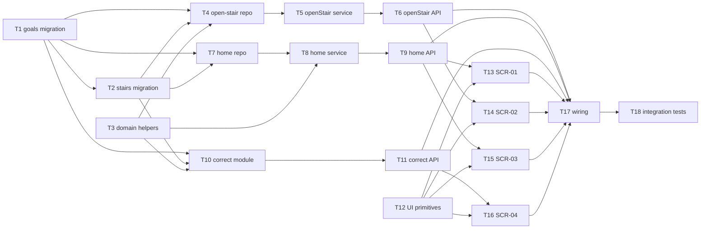

# Epic — focus-steps

> **Spec:** [spec.md](../spec.md) · **Design:** [sad.md](../sad.md) · **Data model:** [data-model.md](../data-model.md) · **API:** [openapi.yaml](../contracts/openapi.yaml) · **ADRs:** [adr/](../adr/) · **Screens:** [screens.md](../screens.md)

## Goal

Ship Focus Steps so the Owner can open one stair under a named goal, count time only while the app is visible, mark the stair done, read finished stairs and a derived goal total, and correct a finished stair's name or time. Records live in the local SQLite file and survive close, crash, or power loss on this computer.

## Scope

- **In:** staged→live migrations for `goals`/`stairs`; modules `open-stair`, `home`, `correct` (`http`/`service`/`repo`); JSON contract routes; SSR screens SCR-01…04 plus `src/ui/styles.css`; loopback wiring and page-visibility pause; Vitest coverage for §5 ACs.
- **Out:** achievements, work/break interval settings, goal finish line, Google Calendar, accounts/sync, moving or deleting finished stairs/goals (`spec.md` §3).

## Task map

## Tasks

See [tracker.md](./tracker.md) for status. Machine contract: [tasks.json](../tasks.json).

| # | Task | Layer | Blocked by | DoD (short) |
|---|---|---|---|---|
| T1 | Promote staged goals migration | migration | — | up/down apply on empty SQLite |
| T2 | Promote staged stairs migration | migration | T1 | up/down apply; one-open unique index present |
| T3 | Name trim/validation + display-elapsed helpers | domain | — | unit tests for trim/empty and display elapsed |
| T4 | open-stair repository | infra | T1, T2, T3 | repo finds/creates goal and inserts open stair |
| T5 | openStair service rules | app | T4 | service covers AC-01/04/06/09/10/11 |
| T6 | POST /api/v1/stairs | ports | T5 | 201/400/409 match OpenAPI |
| T7 | home repository | infra | T1, T2 | repo reads goals/open/finished; finish; pause |
| T8 | home service | app | T7, T3 | getHome/finish/progress/hide match ACs |
| T9 | home/goal/finish/hide API routes | ports | T8 | JSON routes match OpenAPI |
| T10 | correct module service + repo | app | T1, T2, T3 | correct keeps or refuses per AC-07/13/14 |
| T11 | PATCH /api/v1/stairs/{stairId} | ports | T10 | 200/400 match OpenAPI |
| T12 | Shared SSR UI primitives | ui | — | AppShell/button/link/message styles in CSS |
| T13 | Render SCR-01 Home | ui | T9, T12 | default/empty/error states |
| T14 | Render SCR-02 Open a stair | ui | T6, T12 | default + validation states |
| T15 | Render SCR-03 Goal | ui | T9, T12 | default + empty states |
| T16 | Render SCR-04 Correct a stair | ui | T11, T12 | default + validation states |
| T17 | Wire modules + visibility hide | wiring | T6, T9, T11, T13–T16 | app serves product routes on loopback |
| T18 | Integration tests for core flows | tests | T17 | Vitest covers open/finish/progress/correct/hide |

## Risks / Hard rules

- At most one open stair — enforce in `open-stair` service; cover AC-06 (`sad.md` §11).
- Visibility segments: gap while not visible adds 0 s (ADR-0003); goal total derived on read only (ADR-0004) — never a writable `goals.total` column.
- Stair names stored/shown as text, never executed; no account — loopback only (AC-05, `spec.md` §6.1).
- Reuse `src/ui/styles.css` only; no React/Tailwind (`architecture-map.md` §Frontend).
