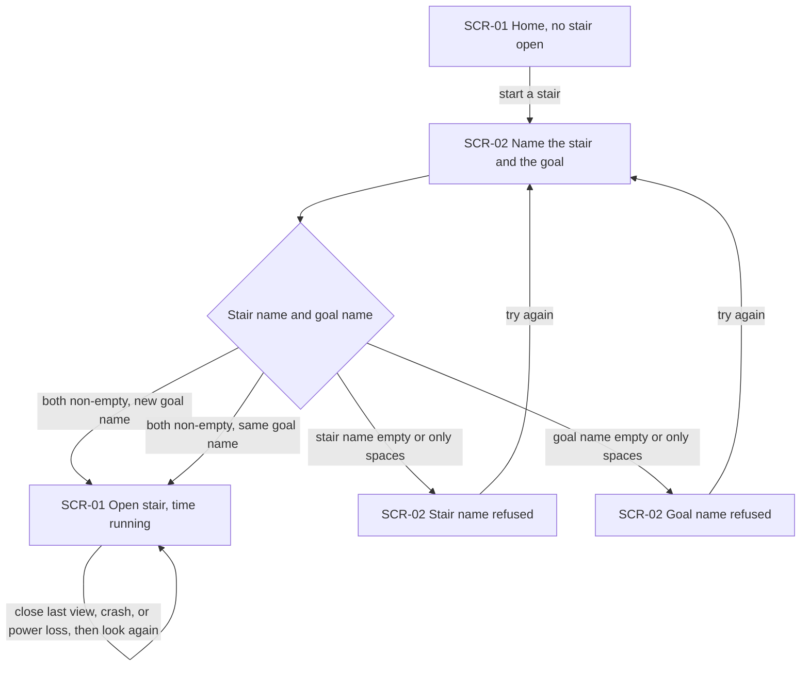
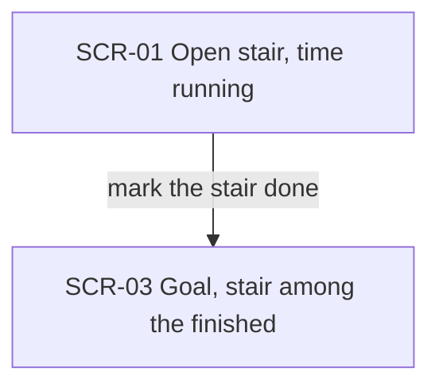
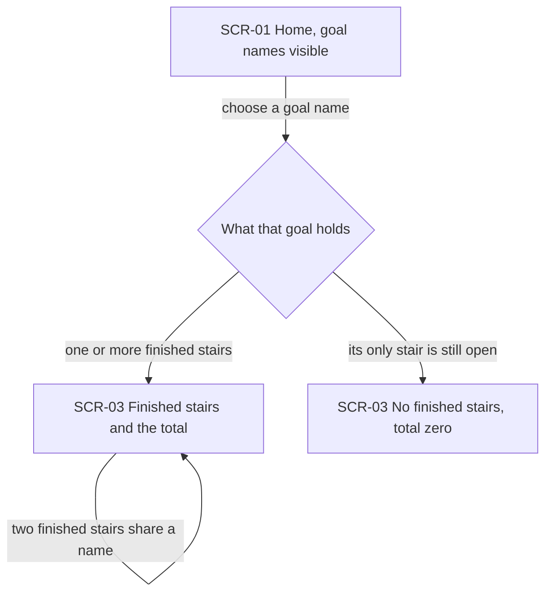
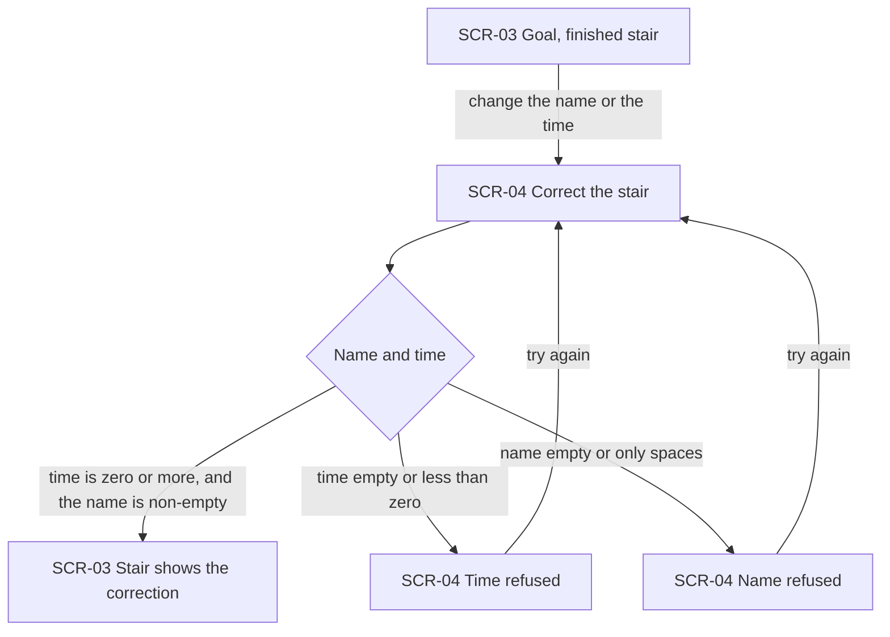
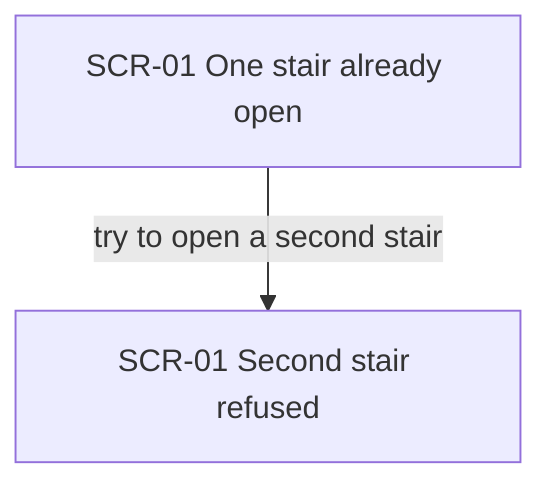

# UX flows — focus-steps

> User flows for every UI-touching §4 user story, produced by `ux-flows` (after `clarify`, before
> `design`) and read by `design` (evidence for the target-surface + UI-architecture decisions),
> `sequences` (UI-driven flows align on SCR ids), `screens` (details every inventory row) and
> `plan-tests` (the e2e-through-UI paths). **Always markdown + mermaid `flowchart`**, whatever the
> design tool — this artifact is flow-altitude, not visual design.

## Platform decisions

- **Posture:** desktop-first — no `docs/design-system.md` yet. The owner uses one local computer. A phone layout was not in the accepted version.
- **Navigation:** the owner moves between pages. A dialog versus a page is not decided here; each SCR is a place they land, not a layout.
- **How a page is delivered** (full load or not) is design input, not a decision in this file.

## Screen inventory

| ID | Screen | Purpose | Entry | Exit |
|---|---|---|---|---|
| SCR-01 | Home | See every goal name, and the one open stair with its name, goal, and time so far | Open the app, or return after a stair opens | Start a stair (SCR-02). Choose a goal name (SCR-03). Mark the open stair done (SCR-03) |
| SCR-02 | Open a stair | Name the stair and the goal in one step | From SCR-01 when no stair is open | SCR-01 when the stair opens. Stay here when a name is refused |
| SCR-03 | Goal | See that goal's finished stairs and their total time. An open stair is not in this list | Choose the goal name on SCR-01, or land here after marking its stair done | Back to SCR-01. Correct a finished stair (SCR-04) |
| SCR-04 | Correct a stair | Change the name or the time of one finished stair | From that stair on SCR-03 | SCR-03 when the correction is kept. Stay here when the name or the time is refused |

## Flows

### Flow: US-01 Open one stair

The owner starts on Home with no stair open and goes to the page where they name the stair and the goal. A stair name that is empty or only spaces stays on that page, creates nothing, and says the name has to be a completed action. A goal name that is empty or only spaces does the same and says the goal needs a name. The product does not judge the words. When both names are non-empty, the stair opens and Home shows its name, its goal, and the time counted so far. A new goal name creates the goal only then. The same characters, after spaces at the ends are ignored, join the existing goal. Capital letters and small letters stay different. Closing the last view, a crash, or a power loss leaves that stair open. Looking again shows it, and the gap adds no time. Several views show that same time once.

### Flow: US-02 Mark the stair done

The owner is on Home, where the open stair shows its name, its goal, and the time counted so far. They mark that stair done. Time stops. They land on the goal, and the stair is among the finished stairs with the time it ran. It is no longer the open stair.

### Flow: US-03 See a goal's progress

The owner looks at Home and sees each goal's name. They open a goal by choosing that name. If the goal has finished stairs, the goal page shows each of them and the total time. If two finished stairs share a name, both are shown and both times are in the total. If the goal's only stair is still open, the page shows no finished stairs and a total of zero, and that open stair is not in the list. This path is on this computer. Someone on another computer is not shown a page at all.

### Flow: US-04 Correct a finished stair

The owner is on the goal, looking at a finished stair, and goes to the page where they change its name or its time. A time of zero or more, with a non-empty name, is kept. They return to the goal, the stair shows the new name or time, and the total uses the new time. A time that is empty or less than zero is not kept. The previous time stays, and the page says the time has to be the time the stair ran. A name that is empty or only spaces is not kept. The previous name stays, and the page says the name has to be a completed action. The stair cannot move to another goal, and it cannot be removed.

### Flow: US-05 Hear why a second stair is refused

The owner is on Home and one stair is already open. They try to open a second. No stair is created and no goal is created. They stay on Home. The first stair is still open, with its name, its goal, and the time counted so far. The page says, in plain language, to mark the current stair done first.

## Stories with no screen

None. Every §4 user story touches the UI. There is no backend-only story left undrawn.

## AC coverage

| AC | Shown by | Notes |
|---|---|---|
| AC-01 | Flow US-01 → both names non-empty, then SCR-01 | Time starts and that stair is the only open one |
| AC-02 | Flow US-02 → mark done, then SCR-03 | Time stops and the stair is among the finished with the time it ran |
| AC-03 | Flow US-03 → one or more finished stairs, then SCR-03 | Each finished stair and the total |
| AC-04 | Flow US-01 → stair name empty or only spaces | Nothing is created. The page says the name has to be a completed action |
| AC-05 | N/A: no screen on another computer | Flow US-03 states the absence. A person at this computer still sees the notes |
| AC-06 | Flow US-05 → try to open a second stair | No stair and no goal are created. The first stays open. The page says to mark it done first |
| AC-07 | Flow US-04 → time is zero or more and the name is non-empty | The stair shows the correction and the total uses the new time |
| AC-08 | Flow US-01 → close the last view, crash, or power loss, then look again | The stair stays open and the gap adds no time |
| AC-09 | Flow US-01 → new goal name | The goal appears only when the stair opens |
| AC-10 | Flow US-01 → goal name empty or only spaces | No goal and no stair. The page says the goal needs a name |
| AC-11 | Flow US-01 → same goal name | Same characters join the existing goal. Capitals differ |
| AC-12 | Flow US-03 → its only stair is still open | No finished stairs and a total of zero. The open stair is not in the list |
| AC-13 | Flow US-04 → time empty or less than zero | The previous time stays |
| AC-14 | Flow US-04 → name empty or only spaces | The previous name stays |
| AC-15 | Flow US-01 → SCR-01 open stair | Name, goal, and time so far are visible, and the stair can be marked done from there |
| AC-16 | Flow US-03 → SCR-01 goal names | The owner opens a goal by choosing its name |
| AC-17 | Flow US-03 → two finished stairs share a name | Both are shown and both times are in the total |
