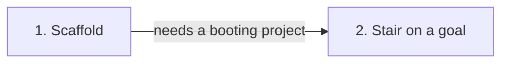

# Roadmap — focus-steps

> **A decomposition, not a promise.** The overall idea broken into incremental steps: what each
> step is, where it comes from, how big it is — or that nobody has looked at it yet — and in which
> order, and parallel lanes, we walk them. **No dates** (except shipped history), **no scores** —
> order is the prioritization. The *solution* for any step lives in its `docs/features/<slug>/`
> spec, not here.

## Destination

The owner opens the local app, records one stair at a time as a smallest completed action with its elapsed time under a named goal, and sees that goal's finished stairs and total time.

## Steps

| # | Step | Source | Size | Status |
|---|---|---|:---:|---|
| 1 | The empty project builds, boots, tests run, and a migration applies and reverts | `docs/architecture-map.md` ## Stack | S | idea |
| 2 | Record one stair under a named goal with its elapsed time, and see that goal's finished stairs and total time | `docs/idea-brief.md` ## 7. Recommendation | M | idea |

## Not yet specified

None. Both steps can be stated precisely, so neither is fog.

## Out of scope

- Achievements and motivational rewards — excluded from the accepted first version in `docs/idea-brief.md` ## 5. Out of scope. Moving this in is a scope change.
- Settings for work-interval length and breaks — same exclusion. The stair records elapsed time. It does not configure a work or break length.
- A finish line on a goal, whether stages or a numeric target — same exclusion. Progress is accumulated time and finished stairs, not distance remaining.
- Moving live lectures out of Google Calendar — same exclusion. The calendar stays where it is.
- An account or sync across computers — the accepted foundation is one SQLite file on this computer (`docs/adr/0003-store-data-in-a-sqlite-file.md`).

## Open decisions

None.

## Decisions so far

- The only intended user is the idea owner → [`docs/idea-brief.md`](idea-brief.md) ## 3. Users
- The first version is one stair, its elapsed time, and finished stairs plus total time under a named goal → [`docs/idea-brief.md`](idea-brief.md) ## 7. Recommendation
- The app is a local TypeScript process that serves HTML, with no account → [`docs/adr/0001-serve-a-local-typescript-web-app.md`](adr/0001-serve-a-local-typescript-web-app.md)
- Each module is HTTP, rules, and SQLite access → [`docs/adr/0002-lay-modules-out-in-three-layers.md`](adr/0002-lay-modules-out-in-three-layers.md)
- Data is one SQLite file, dbmate migrations, and application-generated ULIDs → [`docs/adr/0003-store-data-in-a-sqlite-file.md`](adr/0003-store-data-in-a-sqlite-file.md)

## Dependency graph

## Execution path

| Wave | Steps | Zone per step (why parallel-safe) | Unlocks |
|:---:|---|---|---|
| 1 | 1 | `package.json`, `src/`, `migrations/`, `tests/`, `.github/` (new). Nothing else is in this wave. | 2 |
| 2 | 2 | `src/modules/` (new). A product module beside the skeleton. It waits, because wave 1 creates the tree it lands in. | destination |

## Shipped

| Step | Shipped | Link |
|---|---|---|
